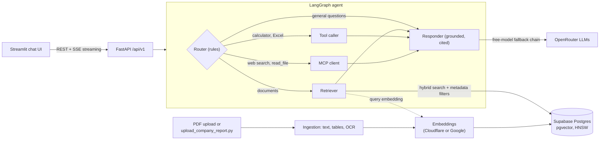

# Agentic RAG Research Platform

[](https://github.com/mubashir-yaseen/agentic-rag-platform/actions/workflows/ci.yml)


An AI research assistant that answers questions **with citations**: from your own PDFs, from the annual reports of
PSX-listed companies, or as a general-purpose assistant. It runs on free tiers only (no paid services).

> **Demo video:** `ADD_VIDEO_LINK` &nbsp;|&nbsp; **Live app:** `ADD_STREAMLIT_LINK`
> (free hosting: the first load can take about a minute while the server wakes up)

## What it does

| Mode | What you get |
|---|---|
| **General Q&A** | A general assistant with a calculator, live web search and Excel export. Your documents are never searched. |
| **My Documents** | Attach a PDF and ask about it. Each visitor sees only their own documents. |
| **Company Research** | Pick a PSX-listed company and ask questions answered from its indexed annual report. |

Every document-based answer lists its sources (file name and page). When the documents do not contain the answer,
the assistant is instructed to say so instead of guessing.

## Architecture



### How a question is answered
1. **Route.** A deterministic, rule-based router picks a path from the selected mode and the question:
   documents (retrieve), calculator, Excel export (search first, then build the file), live web search, or a direct answer.
   There is no LLM call in routing, so it is fast, free and predictable.
2. **Retrieve (hybrid).** The question is embedded and matched against pgvector (cosine similarity, HNSW index).
   Candidates are re-scored with a keyword, bigram and exact-phrase overlap score, table-of-contents chunks are
   down-weighted, and neighbouring chunks are added for context. Filters limit the search by document, company or
   content type.
3. **Answer.** The responder is told to use only the retrieved context, to keep figures such as standalone versus
   consolidated apart, to cite only supporting sources, and to abstain when the evidence is missing. Tokens are streamed
   to the UI over Server-Sent Events. If a model leaks tool-call markup, the response is rejected and retried.
4. **Resilience.** Free LLMs are flaky, so calls go through a fallback chain of models with a per-request timeout and
   a total time budget.

### Ingestion
PDF text (PyMuPDF), tables (PyMuPDF table finder, stored as Markdown), and an OCR fallback for scanned pages
(pytesseract or EasyOCR, when installed). Chunks keep the file name, page number and content type for citations and
filters. The text is embedded in batches and stored with its metadata.

### MCP
The project is both an **MCP client** (the agent calls filesystem and web-search tools through it) and an
**MCP server** that exposes `query_knowledge_base` over stdio (`python -m rag_platform.mcp.server`).

## Engineering for free-tier limits
Everything is built to work without a credit card, which shaped several design decisions:

- **Embedding quotas.** Google's free embedding tier allows 1,000 texts per day, too little for annual reports
  (1,000 to 2,500 chunks each). The platform supports **Cloudflare Workers AI** (`bge-base-en-v1.5`, 768 dimensions)
  as a second provider, picked automatically when its credentials are set.
- **Resumable bulk uploads.** `upload_company_report.py` paces requests under the per-minute limit, waits the time
  the API asks for on HTTP 429, saves every finished embedding and the PDF reading to disk (a re-run continues where it
  stopped), skips placeholder image chunks, and stops at a daily budget that leaves quota for live searches.
- **Small deploy footprint.** No local ML models: embeddings are plain HTTP calls, so the API starts fast and fits the
  512 MB free server.
- **Clear failures.** `/api/v1/diag` reports which keys exist and whether embeddings, the database and vector search
  work; quota problems show a plain-language message instead of a stack trace.
- **Safe public uploads.** Visitors can upload at most 5 PDFs of up to 15 MB each, documents are isolated per visitor,
  and annual reports can only be added by the owner with the service key.

## Evaluation
`eval/run_live_eval.py` runs questions written from the real reports against the deployed API and reports answer
accuracy, correct report and page cited, abstention on unanswerable questions, and latency (p50 / p95).
See [`eval/README.md`](eval/README.md).

<!-- RESULTS: paste the table printed by run_live_eval.py here, with the date and number of questions -->

## Tests and CI
Over 130 unit tests (agent routing, tools, ingestion, API, embeddings, upload pipeline, MCP) run on every push for
Python 3.11 and 3.12. External services are mocked, so the suite needs no secrets:

```bash
pip install -e ".[dev]"
pytest tests/unit
```

## Tech stack
Python, FastAPI, LangGraph, LangChain text splitters, Supabase (Postgres + pgvector), PyMuPDF, OpenRouter (free
models), Cloudflare Workers AI / Google Gemini embeddings, Model Context Protocol, Streamlit, Server-Sent Events,
pytest, GitHub Actions.

## Project structure
```
src/rag_platform/
  api/            FastAPI app, routes (/chat, /ingest, /diag, /health, /files), middleware (rate limit, correlation id)
  agent/          LangGraph graph, tools (retrieval, calculator, web search, Excel), MCP client
  ingestion/      PDF text, tables, OCR, image extraction, chunking pipeline
  vectorstore/    Supabase store, embedding providers, SQL migrations
  mcp/            MCP server
  eval/, observability/
ui/               Streamlit app and chat history store
eval/             live evaluation runner and question template
tests/unit/       unit tests
upload_company_report.py   owner-only bulk uploader for annual reports
```

## Run it yourself
1. **Supabase.** Create a free project. In the SQL editor run the files in
   `src/rag_platform/vectorstore/migrations/` in order (`001`, `002`, `003`). Create a `companies` table
   (`id`, `symbol`, `name`) and add your companies.
2. **Keys.** Copy `.env.example` to `.env` and set:

| Variable | Purpose |
|---|---|
| `SUPABASE_URL`, `SUPABASE_SERVICE_ROLE_KEY` | database |
| `OPENROUTER_API_KEY` | free LLMs |
| `CLOUDFLARE_ACCOUNT_ID`, `CLOUDFLARE_API_TOKEN` | embeddings (recommended) |
| `GOOGLE_API_KEY` | embeddings (alternative, 1,000 texts/day) |

3. **Backend and UI.**
```bash
pip install -e ".[ui]"
uvicorn rag_platform.api.main:app --reload          # API on :8000
API_BASE_URL=http://localhost:8000/api/v1 streamlit run ui/app.py
```
4. **Add annual reports (owner only).**
```bash
python upload_company_report.py --pdf "reports/UBL_AR_2025.pdf" --company-id <id from companies table> --year 2025
```
Set `ADMIN_PASSWORD` in the Streamlit secrets to unlock document deletion in the UI sidebar.

### Deployment
- **API on Render** (Python 3.11): build `pip install --upgrade pip && pip install -r requirements.txt`, start
  `python -m uvicorn rag_platform.api.main:app --host 0.0.0.0 --port $PORT`; set the environment variables above.
- **UI on Streamlit Community Cloud**: main file `ui/app.py`; secrets `API_BASE_URL` and `ADMIN_PASSWORD`.
- Dockerfiles are included under `docker/` (not part of CI).

## Known limitations
- Free tiers: LLM answers can take 20 to 30 seconds, the server sleeps when idle, and the daily embedding quota
  is shared between uploads and searches.
- Company Research searches one company at a time (no cross-company comparison yet).
- Each question is answered on its own; follow-up questions do not use earlier turns.
- OCR and image captioning are optional: they are not available on the free server. Scanned pages were read locally
  when the reports were indexed, and figures are not described by a vision model.
- The embedding model is English-only (`bge-base-en-v1.5`).
- The rate limiter is in memory (per server instance).

## License
MIT
